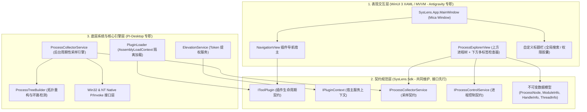
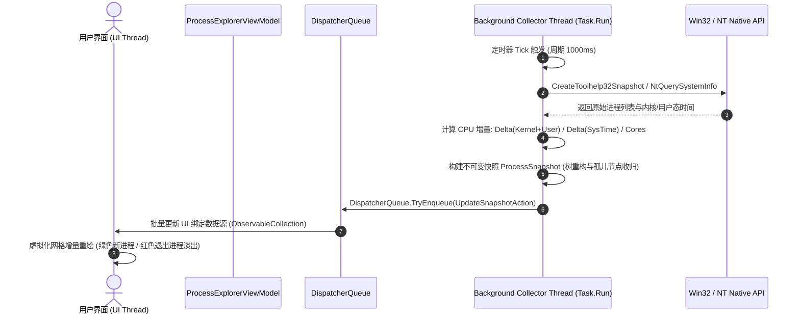

# SysLens 系统架构设计与技术实现 (ARCHITECTURE.md)

## 1. 系统总体架构与分层设计

SysLens 遵循严格的关注点分离与插件化微内核架构，共划分为三层物理架构：



---

## 2. 线程模型与多核异步采样时序

为确保 WinUI 3 界面在千量级进程环境下以 60 FPS 稳定流畅运行，SysLens 严格执行**后台工作线程采样**与**UI 调度队列合并派发**架构：



- **UI 线程保护准则**：UI 线程绝不直接执行耗时的 Win32 系统调用或遍历句柄，所有探测操作均在后台线程异步执行。
- **不可变快照派发**：每轮采样输出完整的只读 `ProcessSnapshot`，UI 绑定直接替换数据引用，彻底消除多线程并发读写共享集合的冲突与锁竞争。

---

## 3. 插件隔离加载架构 (`PluginLoader`)

```mermaid
graph LR
    subgraph Host ALC ["Host Default AssemblyLoadContext"]
        HostExe["SysLens.App.exe"]
        SdkDll["SysLens.Sdk.dll"]
        WinUIDll["Microsoft.WindowsAppSDK.dll"]
    end

    subgraph Plugin1 ALC ["PluginLoadContext 1 (ProcessExplorer)"]
        PEPlugin["SysLens.Tools.ProcessExplorer.dll"]
        PEDependency["专用分析工具依赖..."]
    end

    subgraph Plugin2 ALC ["PluginLoadContext 2 (Future Tool)"]
        FuturePlugin["SysLens.Tools.NetworkMonitor.dll"]
    end

    HostExe -->|扫描 Plugins/ 目录| Plugin1 ALC
    HostExe -->|扫描 Plugins/ 目录| Plugin2 ALC
    Plugin1 ALC -.->|共享引用| SdkDll
    Plugin2 ALC -.->|共享引用| SdkDll
```

- **自定义 `PluginLoadContext`**：
  - 继承自 `System.Runtime.Loader.AssemblyLoadContext`，指定 `isCollectible: true`；
  - 优先从宿主加载已加载的共享程序集（`SysLens.Sdk`），外部专属依赖则从插件子目录独立解析；
  - 杜绝不同插件引入不同版本的依赖库（如 Newtonsoft.Json vs System.Text.Json）产生程序集绑定冲突。
