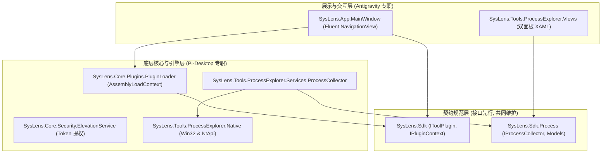

# SysLens 系统架构设计 (ARCHITECTURE.md)

## 1. 架构总览与分层设计

SysLens 遵循严格的关注点分离与插件化微内核架构：

---

## 2. 核心模块与职责划分

### 2.1 SysLens.Sdk（插件契约规范）
- 独立于具体 UI 实现的契约库。
- 定义 `IToolPlugin`，规定工具元数据（ID、名称、图标、分类、版本）与生命周期回调（`InitializeAsync`, `ShutdownAsync`, `CreateView`）。
- 定义 `IPluginContext`，向上注入宿主服务（主题变更通知、导航跳转、配置持久化、提权服务）。
- 定义 `IProcessCollector` 与不可变快照模型 `ProcessSnapshot`、`ModuleInfo`、`HandleInfo`、`ThreadInfo`。

### 2.2 SysLens.Core（宿主内核支撑）
- **`PluginLoader`**：构建独立的 `AssemblyLoadContext`，支持从应用运行目录下的 `Plugins/` 子文件夹探测外部 `.dll`。防止第三方插件依赖项（如 JSON 库、第三方组件）污染宿主进程。
- **`ElevationService`**：通过 `OpenProcessToken` 与 `GetTokenInformation(TokenElevation)` 实时获取权限状态，提供以 `runas` 动词重启当前程序的提权方法。

### 2.3 SysLens.App（WinUI 3 宿主外壳）
- 现代 Windows 11 Fluent 界面入口。
- 左侧 `NavigationView` 自动由 `PluginManager` 发现的插件列表填充。
- 顶部自定义 `TitleBar` 呈现应用标题、管理员权限徽标（[管理员] / [普通权限]）。
- 主内容区通过 `Frame` 或 `ContentControl` 承载当前激活工具的视图。

### 2.4 SysLens.Tools.ProcessExplorer（首款工具）
- **底层采集器 (`ProcessCollector`)**：
  - 双采样点 CPU 使用率计算：`Delta(KernelTime + UserTime) / Delta(SystemTime) / NumberOfCores`。
  - 父子进程树重构算法：从平铺列表构建以树节点嵌套的层级结构，优雅处理孤儿进程（挂载在根节点）。
- **Native 探查器**：
  - 模块枚举：`EnumProcessModulesEx` + `GetModuleInformation`。
  - 句柄枚举：`NtQuerySystemInformation(SystemExtendedHandleInformation)` + 目标进程句柄复制 `DuplicateHandle` + `NtQueryObject`。
  - 线程枚举：`CreateToolhelp32Snapshot(TH32CS_SNAPTHREAD)`。
- **双面板交互界面**：
  - 上方：进程树网格，按 CPU / 内存列排序，快速过滤。
  - 下方：联动多标签页（Modules / Handles / Threads）。
