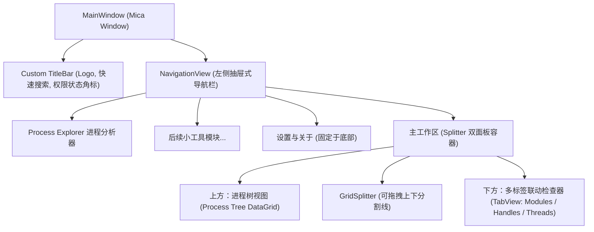

# 前端 UI 设计规范与交互指南 (FRONTEND_UI_GUIDELINES.md)

> **职责归属**：本规范由 **Antigravity 专职维护并实施**。
> 所有前端界面 XAML 视图、样式字典、控件交互逻辑与视觉呈现必须严格遵守本文档。

---

## 1. 界面设计语言与系统材质 (Fluent Design)

SysLens 遵循 Windows 11 现代 Fluent Design 设计语言规范：
- **窗口背景**：主窗口默认启用 **Mica（云母）** 背景材质；在对话框或浮层采用 **Desktop Acrylic（亚克力）** 材质。
- **自定义标题栏 (App TitleBar)**：
  - 隐藏系统原生标准标题栏，采用 `Window.ExtendsContentIntoTitleBar = true`。
  - 标题栏左侧放置 SysLens 矢量 Logo、产品名及当前选中工具名称。
  - 标题栏中间放置全局即输即搜过滤框（Ctrl + F 唤起聚焦）。
  - 标题栏右侧放置**管理员权限状态胶囊徽标**（`[管理员]` 采用绿色强调色，`[普通权限]` 采用灰蓝色提示）。
- **主题适配**：
  - 全面支持深色模式 (Dark) 与浅色模式 (Light)，控件色彩使用系统主题画刷资源（如 `{ThemeResource SystemControlBackgroundChromeMediumLowBrush}`）。
  - 严禁在 XAML 中硬编码高饱和度的纯白 (`#FFFFFF`) 或纯黑 (`#000000`) 作为背景色。

---

## 2. 界面总布局拓扑 (Layout Topology)

---

## 3. Process Explorer 视图规范

### 3.1 上方面板：进程树视图 (Process Tree View)
- **树形层次与缩进**：子进程相对于父进程使用阶梯式缩进（每层缩进 16px），树节点左侧提供展开/折叠三角箭头。
- **动态状态高亮与防抖动画**：
  - **新生成进程**：当检测到新 PID 时，该行背景以 `15% 透明度淡绿色` 高亮持续 1.0 秒，随后淡出恢复正常底色。
  - **退出中进程**：检测到进程消亡时，该行背景以 `15% 透明度淡红色` 高亮持续 1.0 秒后从列表中移除。
  - **已挂起进程**：进程处于 Suspended 状态时，文字颜色呈现半透明中灰度。
- **右键上下文菜单 (Context Menu)**：
  - 结束进程 (`Delete`)
  - 结束进程树 (`Shift + Delete`)
  - 挂起进程 / 恢复进程 (`Ctrl + Space`)
  - 打开文件所在位置
  - 复制（PID / 进程名 / 命令行）
  - 属性...

### 3.2 下方面板：详细联动检查器 (Process Detail View)
当上方选中任意非空进程行时，下方面板通过 `TabView` 联动刷新对应数据：
1. **模块标签页 (Modules)**：列包含模块名称、内存基地址、虚拟内存大小、磁盘完整路径、文件版本、产品说明。
2. **句柄标签页 (Handles)**：列包含句柄十六进制数值、内核对象类型（文件/注册表/互斥体等）、对象路径/名称、访问权限。
3. **线程标签页 (Threads)**：列包含线程 ID (TID)、优先级、状态、上下文切换次数、起始入口地址。

---

## 4. 高刷新率渲染防卡顿规范 (Anti-Lag Guidelines)

1. **虚拟化绝对开启**：
   - 数据列表必须使用支持 UI 虚拟化的容器（如 `ItemsRepeater` 或虚拟化 DataGrid），确保千量级进程行仅实例化当前可视区域内的 30~50 个 UI 元素。
2. **UI 调度批量合并 (Dispatcher Throttling)**：
   - 后台采集线程完成计算后，通过 `DispatcherQueue.TryEnqueue` 派发。
   - 严禁每个进程单独触发一次 UI 通知，必须整批替换或差量合并为不可变快照集合。
