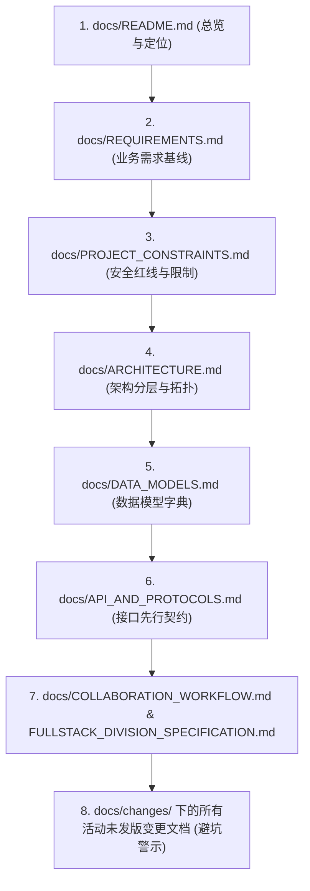

# SysLens 文档体系导航与工程总览 (docs/README.md)

> **设计基线状态**：本文档库是 SysLens 项目的最高权威设计基线与治理枢纽。
> 任何代码实现必须严格遵循本文档库中的规范，严禁绕过规范进行私有或隐式开发。

---

## 1. 项目定位与核心愿景
**SysLens** 是一款面向 Windows 平台高级开发者、逆向工程师与系统运维人员的现代模块化系统工具箱。
- **现代化体验**：深度集成 Windows App SDK (WinUI 3)，支持 Windows 11 Mica（云母）/ Acrylic（亚克力）现代 Fluent 设计语言，具备原生桌面应用的高性能与丝滑交互。
- **微内核插件化**：基于 .NET 8 `AssemblyLoadContext` 提供物理隔离的插件动态装载能力，支持各类观测工具模块的热插拔与独立演进。
- **首款旗舰工具**：深度系统进程分析器（**Process Explorer**），提供高精度多核 CPU/内存增量采样、父子进程树实时渲染、模块/句柄/线程深层探查与平滑 UAC 提权。

---

## 2. 全局文档矩阵与职责导航 (Document Map)

| 核心专题 | 文档路径 | 核心职责与管辖范围 | 责任角色 |
|---|---|---|---|
| **导航总览** | [docs/README.md](./README.md) | 文档体系目录、阅读顺序与规范力度说明 | Antigravity |
| **需求基线** | [docs/REQUIREMENTS.md](./REQUIREMENTS.md) | 业务需求基线（R01~R10）、用户故事与可追溯编号 | Antigravity |
| **项目约束** | [docs/PROJECT_CONSTRAINTS.md](./PROJECT_CONSTRAINTS.md) | 系统安全红线、Windows 特权边界、句柄泄露与管道挂死防御 | Antigravity / PI |
| **技术选型** | [docs/TECH_STACK.md](./TECH_STACK.md) | .NET 8 / WinUI 3 / P/Invoke 依赖版本与选型决策推导 | 共同确认 |
| **系统架构** | [docs/ARCHITECTURE.md](./ARCHITECTURE.md) | 三层微内核架构、进程线程拓扑、数据流与生命周期时序 | Antigravity / PI |
| **接口协议** | [docs/API_AND_PROTOCOLS.md](./API_AND_PROTOCOLS.md) | **接口先行**：插件 SDK、进程探查与控制服务接口契约 | 共同确认 |
| **数据字典** | [docs/DATA_MODELS.md](./DATA_MODELS.md) | 进程树、指标采样、模块、句柄与线程的不可变 DTO 字典 | 共同确认 |
| **界面规范** | [docs/FRONTEND_UI_GUIDELINES.md](./FRONTEND_UI_GUIDELINES.md) | WinUI 3 Fluent 设计、色彩体系、高刷虚拟化网格防卡顿 | Antigravity |
| **工具链契约** | [docs/ENGINEERING_TOOLCHAIN.md](./ENGINEERING_TOOLCHAIN.md) | MSBuild 统一编译配置、Unpackaged 模式与门禁命令 | PI-Desktop |
| **部署与提权** | [docs/DEPLOYMENT_GUIDE.md](./DEPLOYMENT_GUIDE.md) | 单文件发布、运行库依赖、UAC 清单与提权工作流 | PI-Desktop |
| **代码审查** | [docs/CODE_REVIEW.md](./CODE_REVIEW.md) | P/Invoke 安全、UI 线程解耦、GC 压力与反模式防御清单 | 共同确认 |
| **Git 工作流** | [docs/GIT_WORKFLOW.md](./GIT_WORKFLOW.md) | 任务分支管理、Conventional Commits 与 PR 交付标准 | Antigravity |
| **双 Agent 协作** | [docs/COLLABORATION_WORKFLOW.md](./COLLABORATION_WORKFLOW.md) | Antigravity × PI-Desktop 状态机、人工转交与防伪交接 | Antigravity |
| **全栈分工** | [docs/FULLSTACK_DIVISION_SPECIFICATION.md](./FULLSTACK_DIVISION_SPECIFICATION.md) | 前端界面与底层系统引擎的物理路径绝对隔离规约 | Antigravity |
| **版本管理** | [docs/VERSIONING.md](./VERSIONING.md) | SemVer 2.0.0 语义化版本规则与发版聚合闭环 | Antigravity |
| **阶段路线图** | [docs/ROADMAP.md](./ROADMAP.md) | Phase 1~4 演进里程碑、交付清单与阶段退出门禁 | Antigravity |
| **视觉验证** | [docs/VISUAL_VERIFICATION.md](./VISUAL_VERIFICATION.md) | UI 交互、高 DPI、主题切换与千量级渲染的手工实测矩阵 | Antigravity |
| **测试策略** | [docs/TESTING_STRATEGY.md](./TESTING_STRATEGY.md) | 单元测试分层、Native API 隔离与 Mock 确定性测试 | PI-Desktop |
| **验收标准** | [docs/ACCEPTANCE.md](./ACCEPTANCE.md) | A01~A10 逐条可观察验收标准与断言依据 | Antigravity |
| **变更台账** | [docs/changes/README.md](./changes/README.md) | 变更碎片存储库、活动未发版列表与双重视角避坑指南 | Antigravity |
| **规划提案** | [docs/plans/README.md](./plans/README.md) | 重大架构决策提案与技术方案生命周期归档 | Antigravity |
| **验证证据** | [docs/verification/README.md](./verification/README.md) | 本地运行记录、自动化门禁测试证据与实机排障日志 | Antigravity |

---

## 3. 推荐阅读与工程开工顺序
为建立高密度的工程上下文并消除理解偏差，新加入任务的开发者或 AI Agent 必须按照以下顺序进行前置通读：

---

## 4. 规范力度与术语约定
- **【必须】(MUST / SHALL)**：绝对要求，违反将直接被代码审查或门禁脚本阻断。
- **【严禁】(MUST NOT)**：绝对红线，触犯将被立即打回返工。
- **【推荐】(SHOULD)**：在无特殊架构抗辩理由下应当遵循的最佳实践。
- **【可选】(MAY)**：后续特性或扩展能力，不作为当前里程碑的退出门禁。

---

## 5. 双 Agent 角色与物理路径隔离声明
- **前端与交付专职（Antigravity）**：全面负责 `docs/`、`governance/`、`src/SysLens.App/` 界面视图与 Git 交付，严禁侵入底层 Native 进程引擎。
- **底层与核心专职（PI-Desktop）**：全面负责 `src/SysLens.Core/`、`src/Tools/.../Native/` 与 `Services/`，严禁修改前端 XAML 界面与规范文档。
- **接口为王（Interface First）**：前后端仅通过 `src/SysLens.Sdk/` 声明的接口交互，私有实现严禁隐式耦合。
