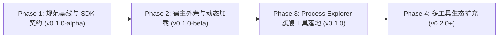

# 阶段演进路线图与退出准则 (ROADMAP.md)

## 1. 里程碑阶段规划 (Milestone Phases)

---

## 2. 阶段详细任务与退出准则 (Phase Criteria)

### Phase 1: 规范基线与 SDK 契约 (`v0.1.0-alpha`)
- **包含任务**：
  - `TASK-GOV-001`：基础治理规范与双 Agent 流程初始化（已完成）
  - `TASK-GOV-002`：全套 20+ 篇工程规范矩阵补齐与深度对标（当前进行中）
  - `TASK-SDK-001`：`SysLens.Sdk` 标准插件契约与模型接口库实现
- **退出准则 (Exit Criteria)**：
  1. `scripts/governance/check.ps1` 校验全套 20 份规范文档完整无缺失；
  2. `SysLens.Sdk` 类库成功编译并输出标准 NuGet/DLL 包；
  3. SDK 自动化契约单元测试 100% 通过。

### Phase 2: 宿主外壳与动态加载 (`v0.1.0-beta`)
- **包含任务**：
  - `TASK-CORE-001`：`SysLens.Core` 插件隔离加载器与 Windows 提权服务
  - `TASK-SHELL-001`：`SysLens.App` WinUI 3 宿主外壳与 Fluent 现代导航窗口
- **退出准则 (Exit Criteria)**：
  1. 宿主 WinUI 3 窗口正常启动，Mica 材质与深浅色模式即时自适应；
  2. 能够动态扫描 `Plugins/` 目录并成功载入测试插件。

### Phase 3: Process Explorer 旗舰工具落地 (`v0.1.0 正式发版`)
- **包含任务**：
  - `TASK-PE-001`：Native 进程采样引擎、CPU 差量计算与进程树重构算法
  - `TASK-PE-002`：双面板交互界面（进程树 + 模块/句柄/线程检查器）联调
- **退出准则 (Exit Criteria)**：
  1. 进程树上方面板毫秒级刷新，支持即输即搜过滤；
  2. 右键操作（结束、挂起、恢复）全部可正常执行；
  3. 下方模块、句柄、线程标签页数据真实准确；
  4. 满足 `docs/ACCEPTANCE.md` 中定义的全部 10 项可观察验收标准。

### Phase 4: 多工具生态扩充 (`v0.2.0+`)
- 后续小工具规划：
  - 网络连接分析器 (Network Monitor)
  - Windows 服务与驱动检查器 (Services Explorer)
  - 启动项与自动运行项检查器 (Autoruns Spy)
