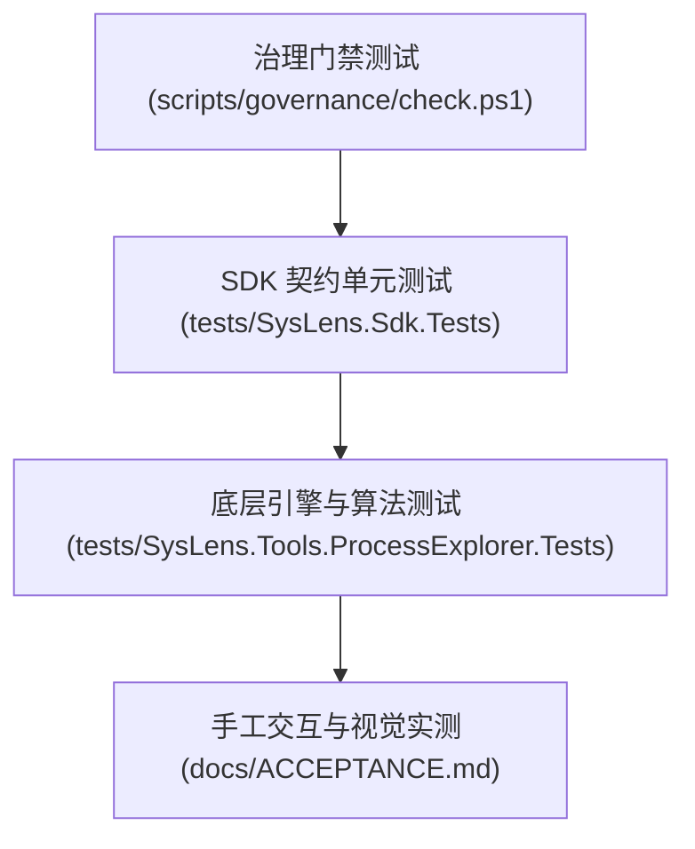

# 测试策略与自动化验证规范 (TESTING_STRATEGY.md)

## 1. 测试分层与原则



1. **零测试禁止发布**：任何核心底层逻辑修改必须包含可运行的自动化测试。
2. **Native 接口测试隔离**：针对 P/Invoke 底层 API 涉及的系统调用，单元测试需针对当前系统自身进程进行只读探测验证，或通过模拟进程（如启动临时无害进程）进行状态验证，严禁直接在单元测试中强杀未授权系统服务。
3. **算法确定性测试**：进程树构建与 CPU 增量计算逻辑必须具备确定性的测试夹具（Mock Process Samples），验证在极端场景（如 PID 回流、父进程提早消亡）下的鲁棒性。

---

## 2. 自动化执行命令
- 治理门禁检查：
  ```powershell
  pwsh scripts/governance/check.ps1
  ```
- 单元测试运行：
  ```powershell
  dotnet test
  ```
