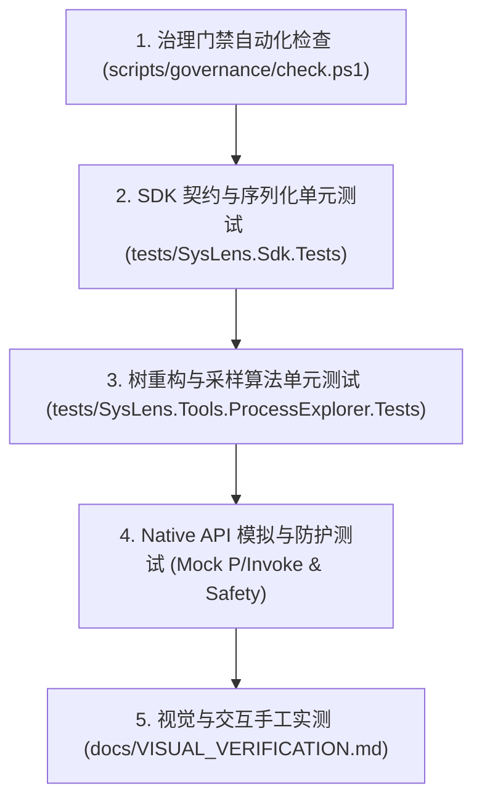

# 测试分层与自动化验证策略 (TESTING_STRATEGY.md)

## 1. 测试分层拓扑与原则



1. **确定性优先 (Determinism)**：核心算法（CPU 增量计算、树拓扑重构、环形引用拦截）必须使用纯内存确定性测试夹具（Mock Process Samples），不依赖当前执行主机的动态环境波动。
2. **零特权自毁红线**：自动化单元测试中严禁尝试挂起或结束未经测试夹具明确启动的系统外部真实进程。测试中所有针对进程控制的用例必须自行启动一次性无害测试进程（如启动挂起的临时子进程）或完全基于 Mock 接口断言。
3. **内存与句柄泄漏压测**：测试套件应包含长时间循环采样微基准测试，监测 GC 堆内存与 Process Handle 计数器。

---

## 2. 核心测试模块与断言矩阵

### 2.1 SDK 契约测试 (`SysLens.Sdk.Tests`)
- **测试内容**：
  - `ProcessNode`、`ModuleInfo` 等记录类型的构造与空值防守。
  - `OperationResult` 成功/失败静态构造方法。
  - 插件元数据契约完整性校验。

### 2.2 树拓扑与环路检测测试 (`SysLens.Tools.ProcessExplorer.Tests`)
- **测试内容**：
  - **常规多级父子树**：验证 `Explorer.exe` -> `CMD.exe` -> `Git.exe` 的层级嵌套关系正确。
  - **孤儿进程优雅收归**：模拟父进程已死（PPID 指向不存在的 PID 99999），断言该进程被正确挂载在根节点列表，不丢弃。
  - **环路递归攻击防御**：构造恶意环形样本（PID 100 的 Parent 为 200，PID 200 的 Parent 为 100），断言算法在检测到成环后强行将环首节点剥离挂至根部，断言递归深度不超过阈值。

### 2.3 CPU 增量计算精度测试
- **测试内容**：
  - 双采样点内核态/用户态时钟增量算法；
  - 模拟双核、四核、八核 CPU 归一化计算，断言输出百分比严格在 0.0% ~ 100.0% 之间。

### 2.4 命名管道超时挂死防护测试
- **测试内容**：
  - 针对带有同步阻塞命名管道句柄的模拟对象调用句柄探查，断言看门狗线程在 50ms 内超时返回，主调用流程正常推进，无永久卡死。

---

## 3. 测试执行命令规范

```powershell
# 1. 运行治理与合规门禁
pwsh scripts/governance/check.ps1

# 2. 运行所有单元测试套件
dotnet test SysLens.sln -c Release --verbosity normal --collect:"XPlat Code Coverage"
```
